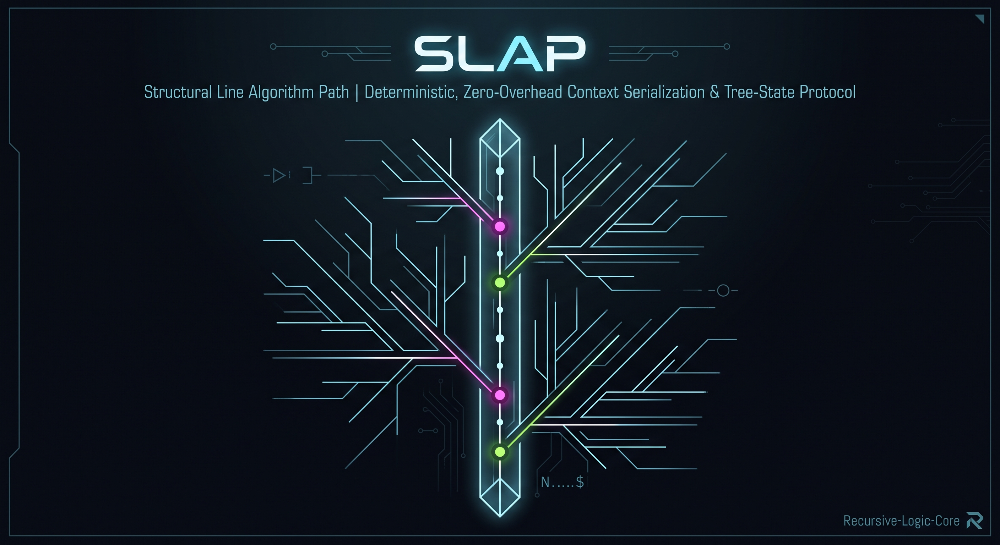

<div align="center">



# SLAP

### Installation
Install via PyPI:

```bash
pip install slap-protocol
```

### Quickstart
```python
import slap

# Encode JSON to SLAP
slap_stream = slap.json_to_slap('{"cluster": {"node": 1}}')

# Parse SLAP back to JSON
json_data = slap.slap_to_json(slap_stream)
```

### Structural Line Algorithm Path

**Deterministic, low-token context serialization and tree-state protocol.**

[](LICENSE)
[]()
[]()

</div>

> **Deterministic Protocol Specification**  
> Designed and specified by Architect M.M.M. Python code provided as a standalone reference implementation artifact.
>
> **Operational Scope: Where SLAP Operates**  
> **SLAP is not a persistent storage engine or a replacement for binary transport protocols (such as Protocol Buffers or CBOR).**  
> It operates as an ephemeral, text-based micro-serialization gateway directly at the **compute and ingestion boundary of Large Language Models**. It transforms heavyweight, bracket-laden payloads into deterministic, token-efficient streams prior to inference without requiring any alterations to existing backend infrastructure (JSON/SQL).

---

## Abstract

Modern data serialization formats (JSON, YAML, XML) carry massive historical ballast: redundant quotation marks, nested closing brackets, fragile indentation rules, and zero native support for state inheritance. When injected into LLM context windows, this syntax overhead directly consumes valuable token budget and working memory.

**SLAP (Structural Line Algorithm Path)** is an ultra-minimalist, line-deterministic protocol designed for pure context efficiency. It maps hierarchical tree topologies and cascading context inheritance using single-character prefix vectors. No brackets, no commas, no syntax noise.

---

## Core Principles

1. **Zero Syntax Overhead:** Only semantic data and explicit prefix markers exist. Structural depth is declared strictly at index `0` of each line.
2. **Deterministic Single-Pass Parsing ($O(N)$):** Evaluated strictly line-by-line using a lightweight finite-state machine. No lookaheads, no backtrack buffers, and no recursion overhead.
3. **Cascading State Inheritance & Dynamic Scope:** Attributes defined at depth $N$ arm the state register strictly forward for all subsequent child nodes and sub-branches declared after them. Prior siblings remain completely immutable.
4. **Visual Depth Indexing & Strict Identifiers:** Eliminates ambiguous whitespace within identifiers (using `_`), making structural misalignment immediately visible.
5. **Drop-in In-Memory Gateway:** Persistence layers remain standard (JSON/SQL). SLAP operates strictly in-memory prior to model ingestion to eliminate token bloat.

---

## Structural Determinism vs. JSON Fallibility

Comparing prefix-based hierarchies to bracketed formats often introduces false equivalencies regarding syntax errors. In practice, SLAP enforces significantly higher structural visibility and a lower error surface area than JSON:

- **Elimination of Invisible Structural Drift:**  
  In JSON, a misplaced closing bracket `}` silently shifts an entire branch into an incorrect parent scope while remaining 100% syntactically valid. The parser accepts it, introducing silent logical corruption that is difficult to locate across large files. In SLAP, depth is declared explicitly at index `0` of each line (`-`, `--`, `---`). Hierarchy is visually auditable at a glance.
- **Strict Whitespace Boundaries:**  
  By disallowing ambiguous whitespace within identifiers, malformed tokens and indentation slips stand out immediately. There are no trailing-comma syntax aborts, no unescaped quote errors, and no dangling delimiter states.
- **Symmetrical Structural Responsibility:**  
  No serialization format can correct an author who misunderstands their own data hierarchy. If an element is declared under the wrong parent node, both JSON and SLAP will faithfully parse that incorrect relationship. However, SLAP guarantees that this hierarchy is transmitted with **zero bracket-closure failure vectors** and **minimal token overhead** during automated state transitions.

---

## Syntax Specification

### 1. Entities & Objects (`-`, `--`, `---`)
- `-` declares a root entity (resets previous context).
- Each additional `-` increases the hierarchical depth level ($N+1$).
- Node identifiers use underscores for separation (`cluster_alpha`, `node_01`).

### 2. Attributes & States (`.`, `..`, `...`)
- **Prefix Depth Binding & Dual Attachment:** The dot count strictly targets that specific hierarchical register (`.` = Depth 1, `..` = Depth 2, etc.). Attributes declared directly under a node attach to that active node at Depth $N$ **and** arm the state register for all subsequent child nodes ($N+1$).
- **Strict Forward Causality:** Attributes apply exclusively to downstream nodes declared after the attribute statement. Prior siblings remain completely immutable.
- **Scope Isolation & Transition:** Declaring a new attribute block at depth $N$ flushes the active register at depth $N$ and clears all deeper child registers. Sub-nodes inherit strictly the currently active scope stack, preventing data bleed across sibling branches.
- **Explicit Register Reset (Empty States):** A bare dot line matching depth $N$ (e.g. `..`) flushes that depth and all deeper registers. It is the canonical operator to declare that a subsequent sibling carries zero own attributes after a predecessor that declared them.
- **Key-Value Splitting:** Evaluated strictly on the first occurrence of `:`. Subsequent colons are preserved as literal string content, natively supporting timestamps, URLs, and encoded values without escape characters.

### 3. Delimiters, Scoping & Parser Contracts
- **Key-Value Splitting:** Parsers evaluate key-value pairs strictly on the first occurrence of `:`. Subsequent colons are preserved as literal string content, natively supporting timestamps, URLs, and encoded values without escape characters.
- **Discrete State Isolation (Scope Resets):** Attribute registers are level-isolated. When a new attribute block appears at depth $N$ after node declarations, all registers from depth $N$ downwards are cleanly flushed. State combinations are achieved through hierarchical depth specialization, guaranteeing strict single-parent lineage and $O(N)$ deterministic evaluation.
- **Execution-Order Invariant:** SLAP is an execution-ordered stream, not an unordered associative map. Line order carries semantic causality and is an intentional architectural invariant.

---

## Orthogonal Simplicity & Edge-Case Topologies

SLAP deliberately rejects syntax bloat for exotic edge cases, adhering strictly to single-character prefixes and downstream causality:

- **No Specialized Syntax for Corner Cases:**  
  Complex, disjoint, or non-linear state requirements do not require new syntax operators. They are mapped using the existing primitives (`-`, `.`) through deliberate structural explicitness (e.g., branch isolation or localized redeclaration).
  
- **Graceful Structural Redundancy:**  
  In scenarios where strict state isolation requires breaking a shared cascade, authors simply introduce an explicit intermediate node or repeat an attribute. Even when intentionally redundant, SLAP's character payload and token density remain vastly superior to equivalent multi-level JSON/YAML envelopes.

- **Invariant Parser Contract:**  
  The reference engine (`SLAP.py`) evaluates strictly line-by-line in a single pass ($O(N)$). It requires zero lookahead buffers and does not negotiate data validity. Whether a tree is hyper-compressed or structurally explicit, the parsing behavior remains entirely deterministic.

---

## Protocol Comparison

### SLAP Representation (In-Memory Prompt Stream)
```text
-cluster_alpha
.zone:eu_central
.security:strict
--node_01
..role:backup
--node_02
..maintenance:true
--node_03
```

### Legacy JSON Representation
```json
{
  "cluster_alpha": {
    "zone": "eu_central",
    "security": "strict",
    "nodes": [
      { 
        "id": "node_01", 
        "zone": "eu_central", 
        "security": "strict" 
      },
      { 
        "id": "node_02", 
        "zone": "eu_central", 
        "security": "strict", 
        "role": "backup" 
      },
      { 
        "id": "node_03", 
        "zone": "eu_central", 
        "security": "strict", 
        "maintenance": "true" 
      }
    ]
  }
}
```

*Result: SLAP reduces character payload by over 50% while completely removing bracket-closure failure vectors.*

---

## Reference Implementation & Gateway

The ecosystem provides two zero-dependency modules depending on integration requirements:

### 1. Standalone Core Parser (`SLAP.py`)
A minimal, lightweight reference engine for direct node extraction and AST building:

```python
from SLAP import parse_nodes, loads

raw_slap_data = """
-alpha
.status:active
--beta
..role:worker
--gamma
..maintenance:true
--delta
"""

# Extract flat node records
nodes = parse_nodes(raw_slap_data)
for node in nodes:
    print(f"Path: {node['path']} | Attributes: {node['attributes']}")

# Or deserialize directly into a Python dictionary
tree = loads(raw_slap_data)
```

### 2. Bidirectional JSON Gateway (`slap_gateway.py`)
For systems engineering, CI/CD pipelines, and runtime serialization between standard JSON payloads and SLAP streams:

```python
from slap_gateway import json_to_slap, slap_to_json

# Convert JSON payload to token-optimized SLAP stream
slap_stream = json_to_slap(json_string)

# Convert SLAP stream back to standardized JSON
restored_json = slap_to_json(slap_stream, indent=2, coerce=True)
```

Admins and DevOps can also run `slap_gateway.py` directly from the command line:

```bash
python slap_gateway.py config.json -o config.slap
python slap_gateway.py --to-json telemetry.slap -o telemetry.json
```

---

## License

This project is licensed under the MIT License - see the [LICENSE](LICENSE) file for details.

## Contact & Architecture Core
Developed and maintained by **Architect M.M.M.**  
Direct contact: `arch_mmm@proton.me`
